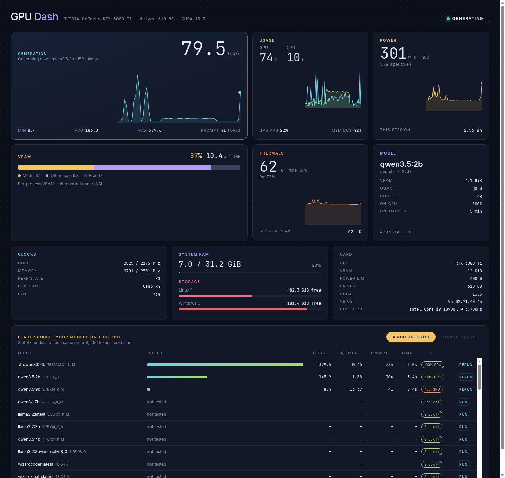

# GPU Bench

A live dashboard for your NVIDIA GPU and local Ollama models. It shows tokens per second, power, heat and VRAM in real time, and includes a leaderboard that benchmarks every model you have installed on your own card.



## What it shows

- **Generation:** live tokens per second while a model is streaming, with min / avg / max and prompt speed
- **Usage:** GPU and CPU load with a 2-minute history
- **Power:** watts against your power limit, joules per token while generating, energy used this session
- **VRAM:** split into the loaded model, other apps and free space
- **Thermals:** temperature, fan speed and session peak
- **Model:** the loaded Ollama model with its size, quantisation, context, GPU share and unload timer
- **Clocks, RAM, storage and card details:** driver, CUDA, VBIOS, PCIe link
- **Leaderboard:** runs the same prompt against each model from a cold start and ranks them by tok/s, J/token, prompt speed, load time and how much of the model fits on the GPU. Untested models get a "should fit / spills to CPU / too big" prediction.

## Requirements

- Python 3.8+ (standard library only, nothing to `pip install`)
- An NVIDIA GPU with `nvidia-smi` available
- [Ollama](https://ollama.com) for the model, tok/s and leaderboard features (the GPU cards work without it)
- Linux or WSL2. Under WSL it opens the dashboard in your Windows browser.

## Run it

```bash
git clone https://github.com/jestie/Gpu_Bench.git
cd Gpu_Bench
./gpudash.sh
```

The dashboard opens at http://localhost:8090. Leave the terminal open while you use it.

## Live tokens per second

Ollama doesn't report speed while it generates, so GPU Bench runs a small pass-through proxy on port **11435**. The proxy forwards everything to Ollama unchanged and counts tokens as they stream past. Point your clients at the proxy to see them on the dashboard:

```bash
# Ollama CLI
OLLAMA_HOST=127.0.0.1:11435 ollama run qwen3:0.6b

# Anything using the OpenAI-compatible API
base_url = "http://localhost:11435/v1"
```

Requests that go straight to port 11434 still work; they just don't show up on the speed card.

## Settings

| Variable | Default | Purpose |
|---|---|---|
| `GPU_DASH_PORT` | `8090` | Dashboard port |
| `GPU_DASH_PROXY_PORT` | `11435` | Token-counting proxy port |
| `GPU_DASH_PROXY_BIND` | `127.0.0.1` | Set to `0.0.0.0` so Docker containers (e.g. Open WebUI) can reach the proxy |
| `GPU_DASH_OLLAMA` | `http://localhost:11434` | Where Ollama really lives |

Run with `--no-browser` to skip opening a browser tab.

Benchmark results are saved to `bench.json` next to the script.

## Licence

MIT. Free to use, change and share.
